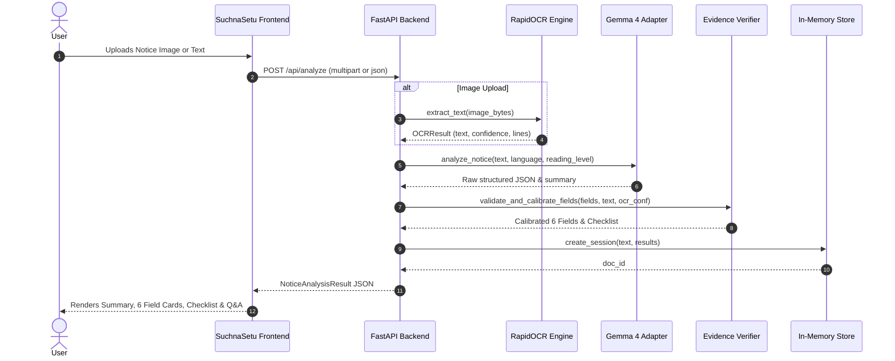

# SuchnaSetu AI — System Architecture
## सूचना + सेतु — Information Bridge
### PS 02: Notice-to-Action Accessibility Assistant | Track 1: Best Use of Gemma 4
**Hacktoberfest 2026 — HackDay@Meerut × E-Cell IIMT University**

---

## 1. High-Level Architecture Overview

SuchnaSetu AI bridges the gap between dense bureaucratic, legal, or institutional circulars and the citizens/students who must act upon them. It operates as an end-to-end accessibility pipeline:

```
[ Notice Source ] ──────► [ Input & Ingestion ] ──────► [ Text Extraction ]
  - Circular Photo         - File Validation (Type/Size)  - RapidOCR Engine
  - Mobile Screenshot      - Paste Input Sanitization     - Direct Text Ingestion
  - Pasted Text Document   - Security / Injection Guard   - Quality & Noise Scoring
                                                                    │
                                                                    ▼
[ Accessibility UI ] ◄─── [ Evidence Layer ] ◄─── [ Gemma 4 Model Engine ]
  - Plain Summary           - Verbatim Substring Matching   - 6 Structured Fields
  - 6 Structured Cards      - Grounded Citation Guard       - Plain-Language Simplify
  - Ordered Checklist       - Uncertainty Detection         - Multilingual (EN / HI)
  - Interactive Q&A         - User Confirmation Tracking    - Grounded Q&A Assistant
  - Text-to-Speech (TTS)    - No-Hallucination Policy
```

---

## 2. Core Subsystems

### A. Document Input & Ingestion Layer
- **Multi-modal Input:** Supports PNG, JPEG, and WebP image uploads up to 15MB, as well as typed or pasted text.
- **Security Safeguards:**
  - MIME-type inspection via Pillow (does not rely on file extensions).
  - Memory bounds and character limits (40,000 character ceiling) to prevent denial-of-service.
  - Notice text is quarantined as untrusted data, preventing prompt injection attacks from hijacking system behavior.

### B. Optical Character Recognition (OCR) Engine
- **Engine:** RapidOCR (ONNX-runtime based).
- **Advantages:**
  - Self-contained in Python wheels without requiring external C++ Tesseract binary installations.
  - Native neural network models for line detection, orientation classification, and character recognition.
  - Preprocessing pipeline: Exif transposition, RGB normalization, contrast leveling.
  - Output: Text string, line coordinates, and word-level confidence metrics.
  - Quality Guard: If average confidence falls below 70%, the notice is flagged with a **Needs Confirmation** warning.

### C. Gemma 4 Intelligence & Inference Adapter
- **Primary Model:** `google/gemma-4-31b-it` (Dense multimodal instruction-tuned) & `google/gemma-4-26b-a4b-it` (Mixture-of-Experts with 3.8B active parameters).
- **Supported Providers:**
  1. **OpenRouter:** Direct access to `google/gemma-4-31b-it` with temperature 0.1 for high factual stability.
  2. **Hugging Face Inference API:** Serverless or dedicated endpoints for Gemma 4 models.
  3. **Local Ollama:** `gemma4:latest` local inference.
  4. **Google AI Studio / Gemini API:** Native API key support.
  5. **Deterministic Evaluation Adapter:** Offline, evidence-grounded fallback ensuring 100% test reproducibility when API keys are unconfigured.

### D. Evidence Verification & Calibration Layer (`evidence_service.py`)
- **Strict Grounding Rule:** Ensures model outputs do not hallucinate missing information.
- **Verification Algorithm:**
  - Verbatim substring search across the extracted OCR text.
  - Sliding-window fuzzy sequence matching (`difflib.SequenceMatcher`) for OCR noise tolerance.
  - If a quoted evidence sentence does not exist in the source notice, the field is demoted to `needs_confirmation`.
  - Date & Pattern Auditing: Scans for ISO/standard date structures to catch ambiguous deadlines.

### E. Session Management & User Confirmation Layer (`session_service.py`)
- **Requirement R7 Adherence:** When an ambiguous or blurry field is reviewed by the user:
  - The original extracted value is preserved intact.
  - The user's confirmed value is stored in `user_confirmations[field_key]`.
  - The status is updated to `confirmed` with an audit timestamp, preventing silent overwrites.

### F. Multilingual & Accessibility Frontend (React + Vite + TypeScript)
- **Design Tokens:** Clean light theme (`#f8fafc`) with deep emerald (`#047857`) and teal (`#0d9488`) trust accents.
- **Typography:** `Inter` for Latin characters and `Noto Sans Devanagari` for clear Hindi rendering.
- **Audio Synthesis:** Integrates browser `window.speechSynthesis` for spoken read-aloud functionality in both English and Hindi.
- **Keyboard Navigation:** Semantic HTML5 (`<header>`, `<main>`, `<section>`, `<article>`), ARIA labels, and `:focus-visible` outlines.

---

## 3. Data Flow Diagram


